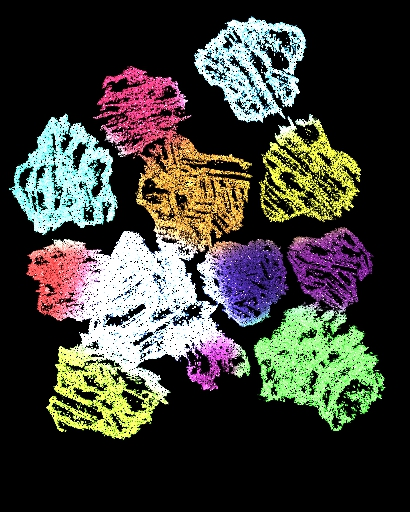
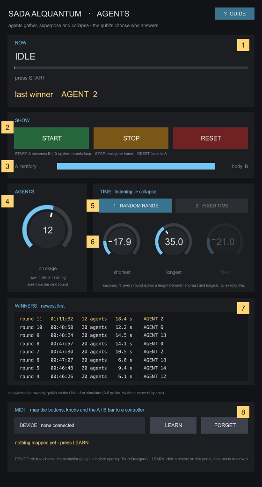

# Quantum

**Sada AlQuantum · AGENTS** — a real-time TouchDesigner piece by Göktuğ Kahyaoğlu.

Up to twenty agents share one field of half a million particles. In every round they
listen, fall into superposition and collapse, and a quantum draw (Qiskit Aer) decides
which agent answers. The texture of every agent is the interference pattern of an
n-qubit state.

<p align="center"></p>

---

## 1. Download

**[Download Quantum-macOS.zip](https://github.com/Liquidam/Quantum/releases/latest/download/Quantum-macOS.zip)**
(about 32 MB, from the [Releases](https://github.com/Liquidam/Quantum/releases) page).

Unzip it. You get one folder with two things in it:

| | |
|---|---|
| `Quantum.toe` | the piece |
| `pylibs/` | the Qiskit quantum simulator (Apple Silicon Macs). **Keep it next to `Quantum.toe`.** |

You also need **TouchDesigner 2025.32820 or newer** (the free licence is fine) from
[derivative.ca](https://derivative.ca/download).

> Without `pylibs` everything still works. The winner of each round is then drawn by
> Python's random generator instead of the quantum simulator. The field itself is
> identical.

## 2. Before you open it

1. **Plug in your MIDI controller** (if you use one). TouchDesigner looks for MIDI devices only when it starts.
2. **Connect the projector / second screen** (if you show the piece).

## 3. Open it

Double-click `Quantum.toe`. Give it 10–20 seconds. **Three windows open by themselves:**

| window | what it is | open it again |
|---|---|---|
| **CONTROL** | the panel you run the piece with | `ctrl` + `1` |
| **HOW TO** | the full step-by-step guide, inside TouchDesigner | `ctrl` + `2`, or the **? GUIDE** button on the panel |
| **FINAL IMAGE** | the final image, live, on this screen | `ctrl` + `3` |

<p align="center"></p>

The HOW TO window has seven tabs: START, THE PANEL, RUN, SCREEN, MIDI, KEYS, HELP.
**Everything below is also explained there.**

On macOS, the shortcuts use the **control** key (`ctrl`), not `cmd`.

## 4. The CONTROL panel

On the HOW TO window's **THE PANEL** tab, gold numbers appear on the real panel. They match this list:

<p align="center"></p>

1. **NOW** — the phase, a progress bar, round, number of agents, length, and the winner (gold).
2. **START · STOP · RESET** — START begins the piece. STOP lets everyone relax home, then waits. RESET goes back to the very beginning and clears the image's memory.
3. **A ↔ B bar** — left = A territory (a board of fields), right = B body (moving bodies). START moves it to B by itself.
4. **AGENTS** — how many agents are on stage, 2 to 20. Fewer agents = bigger agents.
5. **TIME mode** — `1 RANDOM RANGE`: each round gets a random length between *shortest* and *longest*. `2 FIXED TIME`: each round lasts exactly *fixed*.
6. **Time knobs** (seconds) — shortest / longest for mode 1, fixed for mode 2.
7. **WINNERS** — the last 8 rounds, newest on top.
8. **MIDI** — map any controller (section 7).

Knobs: click and drag up or down, or use the mouse wheel.

## 5. Run the piece

1. Set AGENTS and TIME.
2. Press **START**. From A, the board first becomes bodies (10 s), then the rounds loop on their own.
3. Press **STOP** to end.

One round:

| phase | what happens | length |
|---|---|---|
| 1 Listening | agents lean to the middle, their breathing falls into sync | TIME (phases 1–3 together) |
| 2 Superposition | short and chaotic: flicker, random kicks | |
| 3 Collapse | the qubits draw the winner; it grows, the others flow into it | |
| 4 Answer | the winner fills the screen | 8 s |
| 5 Return | everyone back home | 5 s |

RESET clears the image's memory; the look then needs a while to build up again.

## 6. Projector and recording

| press | does |
|---|---|
| `ctrl` + `9` | open the output window (1080 × 1350, no border) on the second screen, or this screen if there is only one |
| `ctrl` + `0` | close the output window |
| `ctrl` + `8` | video recording on / off |
| `ctrl` + `7` | save one still image |
| `ctrl` + `` ` `` | **rebirth of all particles — never during a show** (ugly for minutes) |

Recordings go to the folder `OUT_Quantum` next to `Quantum.toe`. The output window and
the recordings show exactly the final image.

## 7. Play it from a MIDI controller

Any controller works: pads, buttons, knobs, faders. On the panel's **MIDI** card:

1. **DEVICE** shows your controller. If not, click it until it does.
2. Click **LEARN** (it turns gold).
3. Click the panel control you want, for example START. In learn mode a click only *selects*.
4. Press or move the control on your device. A gold label such as `note 36` or `cc 21` appears next to it.
5. Repeat 3–4 for the other controls, then click **LEARN** again to finish.
6. Save: **File > Save**.

| panel control | use on the controller |
|---|---|
| START, STOP, RESET, TIME 1, TIME 2 | a pad or a button (one press = one click) |
| AGENTS, shortest, longest, fixed, A ↔ B bar | a knob or a fader (bottom = lowest, top = highest) |

To remove a mapping: LEARN, click the panel control, then FORGET.

## 8. Troubleshooting

| | |
|---|---|
| No panel | `ctrl` + `1`, or right-click the green CONTROL box > View |
| No image window | `ctrl` + `3` (preview) or `ctrl` + `9` (projector) |
| MIDI device not listed | save, close TouchDesigner, plug it in, open the file again, click DEVICE |
| MIDI does nothing | DEVICE must show its name and LEARN must be off; the status line shows "last in: …" for every message |
| Black or faint after RESET | normal, the image builds up again by itself |
| Winners say "python" | `pylibs` is not next to `Quantum.toe` |
| Yellow warning about 1280 pixels | the free licence limits the image size; expected |

---

## How it works (for the curious)

The main network is laid out in labelled bands; open any box to see numbered signs.

```
/project1
  GUIDE           the HOW TO window
  CONTROL         the panel (logic: CONTROL/actions, MIDI: CONTROL/midi + midi_map)
  Pop_glsl_sort   the piece
     1 STAGE          round manager (STAGE_KUME), the dials it writes (ajan_par), the draw log
     2 AGENT CENTRES  twenty soft discs on the CPU: contact, attraction, wander, collapse
     3 QUANTUM FIELD  the n-qubit state (Qiskit, or the same gates in NumPy)
     4 PARTICLES      524,288 particles on the GPU, shader SADA FIELD (SPH + agent basins + field)
     5 RENDER
     6 CURTAIN        the feedback loop that builds the look (one colour only)
     7 COLOUR         colour per agent, after the curtain -> out_ajan = the final image
  FINAL_OUTPUT    the final image
  cntrl           keyboard shortcuts, output window, recorders
```

`source/` holds readable copies of the code that lives inside `Quantum.toe`
(the particle shader, the colour pass, the stage manager, the agent centres, the quantum
state, the panel logic and MIDI learn). The `.toe` already contains all of it; edit the
code inside TouchDesigner.

## Licence

MIT © 2026 Göktuğ Kahyaoğlu — see [`LICENSE`](LICENSE).
Third-party components keep their own licences — see [`THIRD_PARTY_NOTICES.md`](THIRD_PARTY_NOTICES.md).
