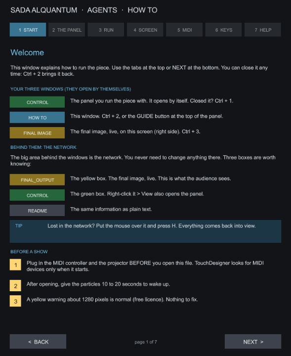

# Quantum

**Sada AlQuantum · AGENTS** — a real-time TouchDesigner piece by Göktuğ Kahyaoğlu.

Up to twenty agents share one field of half a million particles. In every round they
listen, fall into superposition and collapse, and a quantum draw (a measurement of
qubits in equal superposition) decides which agent answers. The texture of every agent is the interference pattern of an
n-qubit state.

<p align="center"></p>

---

## 1. Download

**[Download Quantum-macOS.zip](https://github.com/Liquidam/Quantum/releases/latest/download/Quantum-macOS.zip)**
(from the [Releases](https://github.com/Liquidam/Quantum/releases) page).

Unzip it. You get one folder with `Quantum.toe` in it. Nothing else to install, and
macOS asks for no security permissions: the quantum simulation runs on NumPy, which is
built into TouchDesigner.

You also need **TouchDesigner 2025.32820 or newer** (the free licence is fine) from
[derivative.ca](https://derivative.ca/download).

> If Qiskit and Qiskit Aer are installed where TouchDesigner's Python can find them, the
> draw uses Qiskit Aer instead (the log then says `aer-3q` rather than `sv-3q`). The
> circuit and the probabilities are the same.

## 2. Before you open it

1. **Plug in your MIDI controller** (if you use one), and switch on the **IAC Driver** if you want to send the winner to Max/MSP (section 7). TouchDesigner looks for MIDI devices only when it starts.
2. **Connect the projector / second screen** (if you show the piece).

## 3. Open it

Double-click `Quantum.toe`. Give it 10–20 seconds. **Three windows open by themselves:**

| window | what it is | open it again |
|---|---|---|
| **CONTROL** | the panel you run the piece with | `ctrl` + `1` |
| **HOW TO** | the full step-by-step guide, inside TouchDesigner | `ctrl` + `2`, or the **? GUIDE** button on the panel |
| **FINAL IMAGE** | the final image, live, on this screen | `ctrl` + `3` |

<p align="center"></p>

The HOW TO window has seven tabs: START, THE PANEL, RUN, SCREEN, MIDI, KEYS, HELP.
**Everything below is also explained there.**

On macOS, the shortcuts use the **control** key (`ctrl`), not `cmd`.

## 4. The CONTROL panel

On the HOW TO window's **THE PANEL** tab, gold numbers appear on the real panel. They match this list:

<p align="center"></p>

1. **NOW** — the stage, a progress bar, round, number of agents, what comes next, and the winner (gold).
2. **AUTO · MANUAL** — AUTO: rounds run and loop by themselves on the TIME settings. MANUAL: every stage waits for you (or your MIDI controller).
3. **The five stages** — `1 START` (listening), `2 SUPERPOSITION`, `3 COLLAPSE`, `4 ANSWER`, `5 RETURN`. They work in both modes.
4. **STOP · RESET** — STOP lets everyone relax home, then waits. RESET goes back to the very beginning and clears the image's memory.
5. **A ↔ B bar** — left = A territory (a board of fields), right = B body (moving bodies). START moves it to B by itself.
6. **AGENTS** — how many agents are on stage, 2 to 20. Fewer agents = bigger agents.
7. **TIME mode** — `1 RANDOM RANGE`: each round gets a random length between *shortest* and *longest*. `2 FIXED TIME`: exactly *fixed*. In MANUAL it sets how fast each stage moves.
8. **Time knobs** (seconds) — shortest / longest for mode 1, fixed for mode 2.
9. **WINNERS** — the last 8 rounds, newest on top.
10. **MIDI** — map any controller, and send the winner's number out (section 7).
11. **OUTPUT** — the shape and resolution of the picture, and the projector window (section 6).

Knobs: click and drag up or down, or use the mouse wheel.

## 5. Run the piece

**MANUAL — you play the stages** (the default)

1. Set AGENTS.
2. Press **1 START**. From A, the board first becomes bodies (10 s), then listening begins.
3. Press **2, 3, 4, 5** when the music asks for it. Each stage plays its movement, then **holds** until the next press. NOW shows `holding - next: …`.
4. Between **4 ANSWER** and **5 RETURN**, change AGENTS: the new number arrives during the return.
5. After RETURN the stage waits. Press **1 START** for the next round.

**AUTO — it runs by itself.** Click AUTO and press 1 START. The rounds repeat on the TIME settings. The stage buttons still work: a press jumps there and the round carries on from it.

| stage | what happens | AUTO length |
|---|---|---|
| 1 Listening | agents lean to the middle, their breathing falls into sync | TIME (stages 1–3 together) |
| 2 Superposition | chaos: flicker, random kicks | |
| 3 Collapse | the qubits draw the winner; it grows, the others flow into it | |
| 4 Answer | the winner fills the screen | 8 s |
| 5 Return | everyone back home | 5 s |

Any order is safe: a stage always starts from where the image is, so nothing jumps. Pressing 1 or 2
while a winner is on stage first sends everyone home. RESET clears the image's memory; the look then
needs a while to build up again.

## 6. Projector and recording

Everything is on the panel's **OUTPUT** card. Choose before the show:

| | |
|---|---|
| **IMAGE** | the shape of the picture: `16:9` (default), `16:10`, `4:3`, `SCREEN` (the shape of the output screen) or `4:5` portrait. The agents re-seat in the new shape: give it a minute. |
| **RESOLUTION** | `AUTO` = full detail (the same number of pixels in every shape). `2160` / `1440` / `1080` / `720` = that height: lighter for the computer, coarser texture. Resizing a window does not change it. |
| **SCREEN** | where the output window opens. Click for the next display. `AUTO` = the projector (the last display that is not the main one). |
| **SIZE** | `FULL SCREEN` fills that display, or a fixed size (1920 × 1080 … 800 × 600) in its middle. |
| **OPEN / CLOSE** | the output window, no border (also `ctrl` + `9` / `ctrl` + `0`). Changing SCREEN or SIZE while it is open moves it at once. |

The picture keeps its shape: if the window has another shape, black bars fill the rest.

| press | does |
|---|---|
| `ctrl` + `9` | open the output window (screen and size from the OUTPUT card) |
| `ctrl` + `0` | close the output window |
| `ctrl` + `3` | the FINAL IMAGE preview on this screen; press again for a LARGE preview |
| `ctrl` + `8` | video recording on / off |
| `ctrl` + `7` | save one still image |
| `ctrl` + `` ` `` | **rebirth of all particles — never during a show** (ugly for minutes) |

Recordings go to the folder `OUT_Quantum` next to `Quantum.toe`. Videos are Apple ProRes 422 LT
(works with every TouchDesigner licence; about 2–3 GB per minute at full resolution).

> The preview window keeps the picture's shape when you drag its border: TouchDesigner locks a
> window to the shape of what it shows. Use `ctrl` + `3` twice for a large preview, and the
> OUTPUT card for the projector.

## 7. Play it from a MIDI controller

Any controller works: pads, buttons, knobs, faders. On the panel's **MIDI** card:

1. **DEVICE** shows your controller. If not, click it until it does.
2. Click **LEARN** (it turns gold).
3. Click the panel control you want, for example `2 SUPERPOSITION`. In learn mode a click only *selects*.
4. Press or move the control on your device. A gold label such as `note 36` or `cc 21` appears next to it.
5. Repeat 3–4 for the other controls, then click **LEARN** again to finish.
6. Save: **File > Save**.

| panel control | use on the controller |
|---|---|
| the five stages, AUTO, MANUAL, STOP, RESET, TIME 1, TIME 2 | a pad or a button (one press = one click) |
| AGENTS, shortest, longest, fixed, A ↔ B bar | a knob or a fader (bottom = lowest, top = highest) |

To remove a mapping: LEARN, click the panel control, then FORGET.

### MIDI OUT: the winner's number

At every answer the winning agent's number (**1–20**, as shown on the panel) is sent as a
Control Change, at the moment the qubits are measured. On the **MIDI OUT** row of the MIDI card:

1. **OUT** — click to choose the output device (click again to cycle; one position is *off*).
2. **CC** and **CH** — the controller number and the channel. Click the right half for +1,
   the left half for −1, or use the mouse wheel. Default: CC 20, channel 1.

To receive it in Max/MSP on the same Mac: open **Audio MIDI Setup > Window > Show MIDI Studio**,
double-click **IAC Driver**, tick **Device is online**, then open `Quantum.toe` and choose
`IAC Driver Bus 1` as OUT. In Max, `[ctlin 20 1]` outputs the agent number.

## 8. Troubleshooting

| | |
|---|---|
| No panel | `ctrl` + `1`, or right-click the green CONTROL box > View |
| No image window | `ctrl` + `3` (preview) or `ctrl` + `9` (projector) |
| Output on the wrong screen | click SCREEN on the OUTPUT card until it names the projector; not listed? `ctrl` + `0`, connect it, click SCREEN again |
| Computer struggles | OUTPUT card: RESOLUTION 1440 or 1080 |
| MIDI device not listed | save, close TouchDesigner, plug it in, open the file again, click DEVICE |
| MIDI does nothing | DEVICE must show its name and LEARN must be off; the status line shows "last in: …" for every message |
| Black or faint after RESET | normal, the image builds up again by itself |
| No MIDI OUT device | switch on the IAC Driver (section 7), close TouchDesigner, open the file again, click OUT |
| Yellow warning about 1280 pixels | the free licence limits the image size; expected |
| No video file with the free licence | fixed in 1.2: videos are ProRes (H.264 needs a Commercial licence) |

---

## How it works (for the curious)

The main network is laid out in labelled bands; open any box to see numbered signs.

```
/project1
  GUIDE           the HOW TO window
  CONTROL         the panel (logic: CONTROL/actions, MIDI: CONTROL/midi + midi_map, MIDI OUT: midi_out)
  Pop_glsl_sort   the piece
     1 STAGE          round manager (STAGE_KUME), the dials it writes (ajan_par), the draw log
     2 AGENT CENTRES  twenty soft discs on the CPU: contact, attraction, wander, collapse
     3 QUANTUM FIELD  the n-qubit state (NumPy gates; Qiskit if installed, same result)
     4 PARTICLES      524,288 particles on the GPU, shader SADA FIELD (SPH + agent basins + field)
     5 RENDER
     6 CURTAIN        the feedback loop that builds the look (one colour only)
     7 COLOUR         colour per agent, after the curtain -> out_ajan = the final image
  FINAL_OUTPUT    the final image
  cntrl           keyboard shortcuts, image_format (shape + resolution), output (projector window), recorders
```

`source/` holds readable copies of the code that lives inside `Quantum.toe`
(the particle shader, the colour pass, the stage manager, the agent centres, the quantum
state, the panel logic, MIDI learn, the image format and the output window). The `.toe` already contains all of it; edit the
code inside TouchDesigner.

## Licence

MIT © 2026 Göktuğ Kahyaoğlu — see [`LICENSE`](LICENSE).
Third-party components keep their own licences — see [`THIRD_PARTY_NOTICES.md`](THIRD_PARTY_NOTICES.md).
